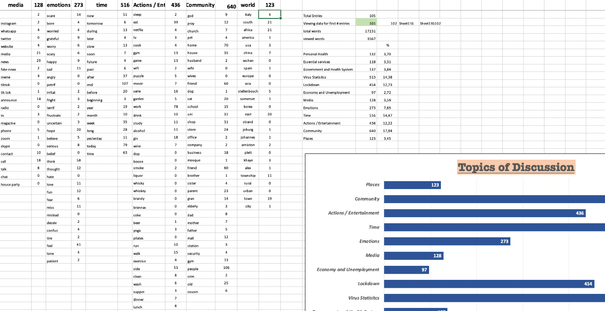
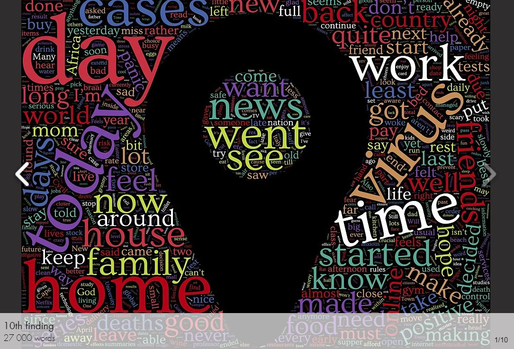
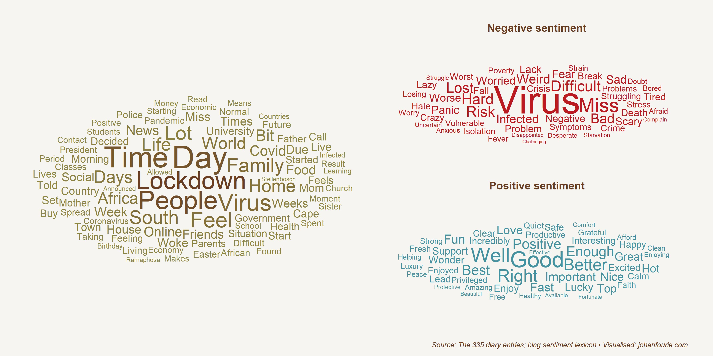
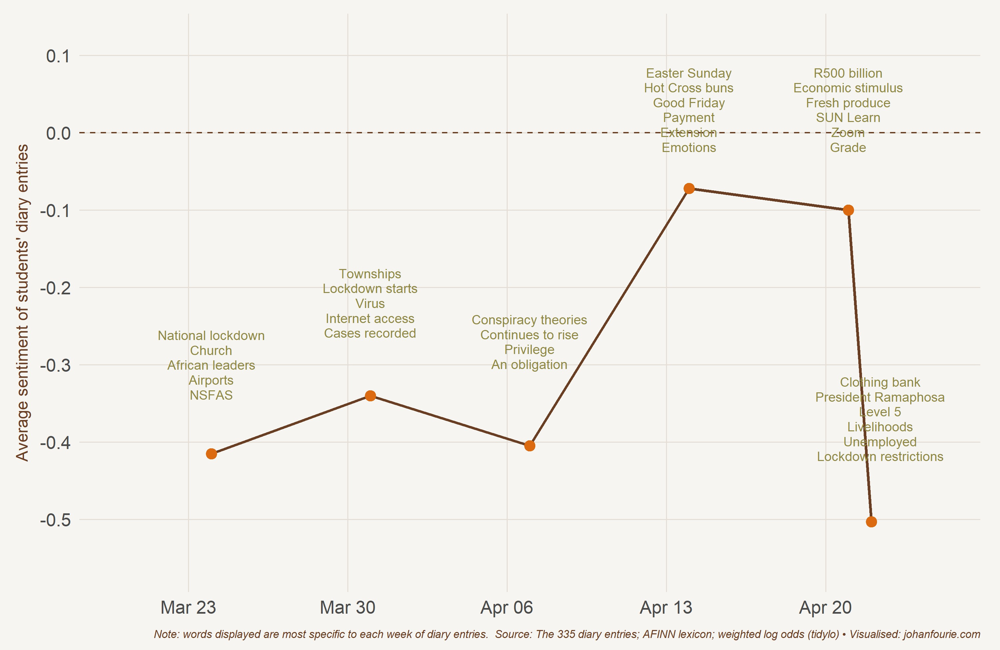
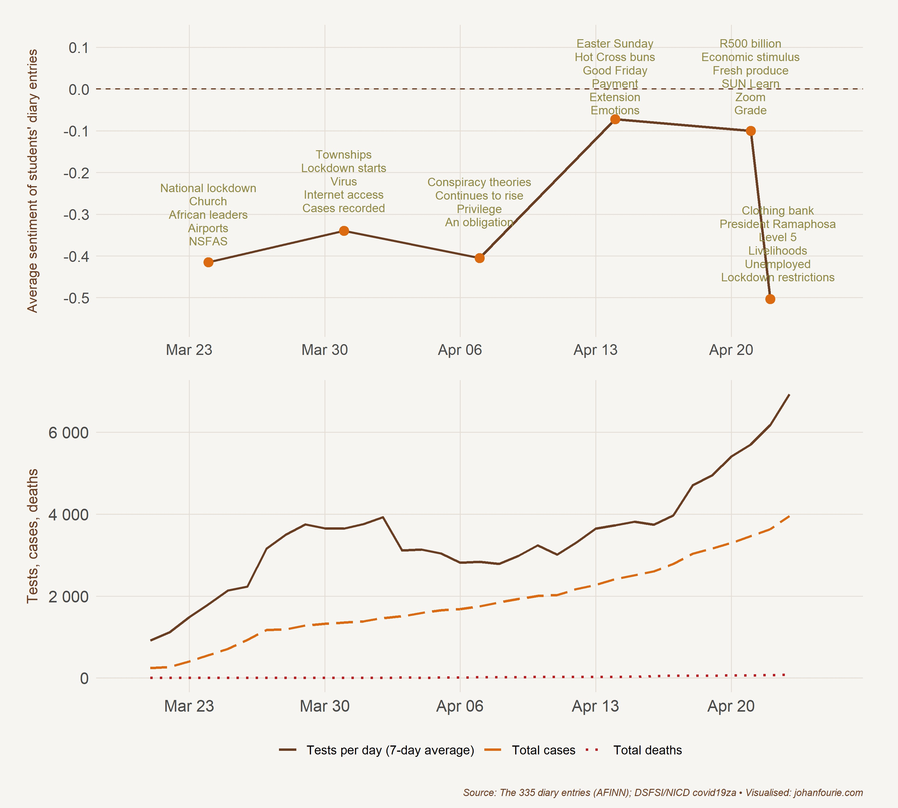
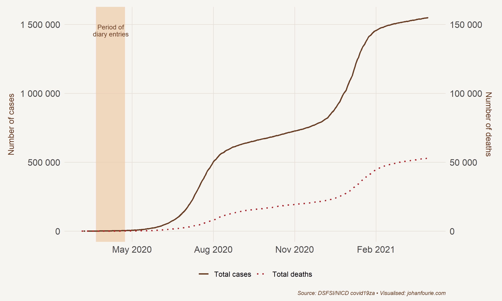
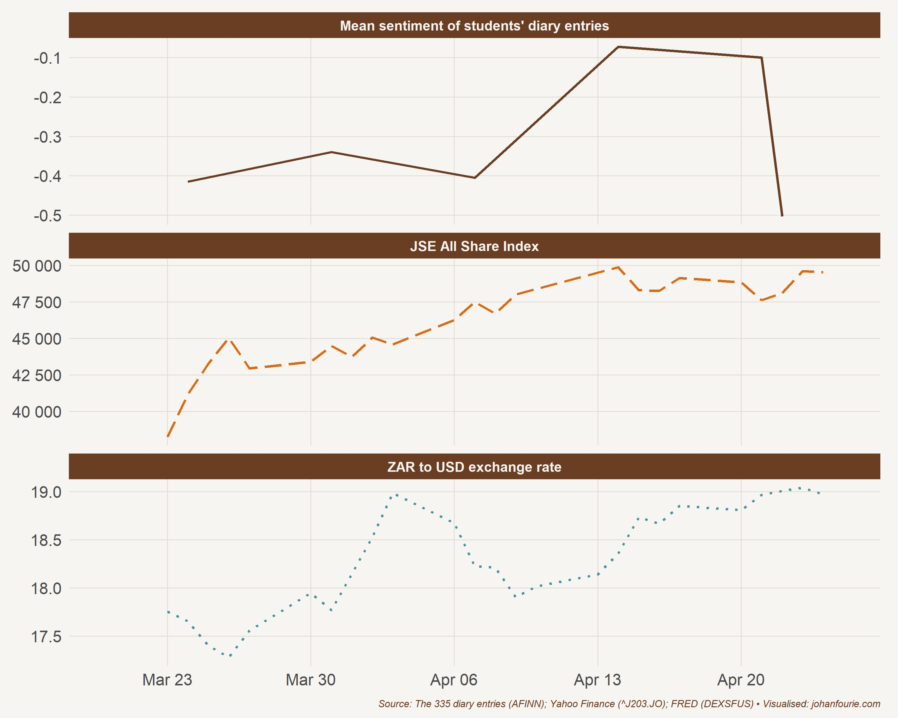

::: {.byline}
Johan Fourie[^1] and Laura Richardson[^2]
:::

## Introduction

In addition to killing more than four million people globally in 2020, the Covid-19 pandemic shut down social and economic activity as governments across the world announced national lockdowns and travel bans. While mortality and morbidity statistics reflect the tragic death toll of the pandemic and the collapse of gross domestic products reveal its dire economic consequences, far less is known about what ordinary people thought, felt and experienced at the onset of this extraordinary period. This anthology is an attempt to (partially) fill that gap. As we explain below, we collected 335 diary entries of Economics 281 students at Stellenbosch University. These entries expose the fears, hopes and beliefs of young people living in South Africa during the first month of the national lockdown. The aim of this anthology is two-fold: to preserve and to reflect, both for those who experienced Covid-19 and for future generations.

## Writing during the pandemic

On 12 March 2020, a day after the World Health Organisation (WHO) declared Covid-19 a pandemic, American literary critic and biographer, Ruth Franklin, published a tweet urging members of the public to keep a record of their experiences. “A suggestion for coping with Covid-19 anxiety: write down what’s happening. Whether you call it note-taking, keeping a journal, whatever – it’s calming and also serves as a useful record”, she wrote.[^3] A day later she reminded her followers to take some notes in another tweet: “Write down what’s happening, what you see around you, how you feel about it. Do it a few times a day, because by evening, what you were thinking in the morning may have been overtaken by new events. When this is over, we’ll want a record.”[^4] Again two days later: “Take a moment and make some notes about what’s happening. Call it your Coronavirus diary, your plague journal, whatever. It’s important. Later, you will want a record.”[^5]

The idea to record people’s lived experiences during the Covid-19 pandemic would later be echoed by academics and journalists across the globe – so much so, in fact, that numerous writing guides and articles promising help to first time writers to “organize their thoughts during these difficult times” have now been published.[^6] The concept of a coronavirus diary has also prompted a range of fascinating new academic projects to emerge. Michael Ward’s *CoronaDiaries* project is a good example. The project aims to “record and archive the experiences of people living through the [coronavirus] crisis and after it by collecting written or visual documents, testimonies and accounts, similar to those collected before, during and after the Second World War in the Mass Observations Studies”.[^7]

Historian Herbert Braun has launched a comparable, albeit slightly more targeted, project at the University of Virginia by inviting all of his current and former students to participate in a voluntary record-keeping exercise in which they write about their daily lives during this “unprecedented time”.[^8] University libraries all over the world are also in the process of collecting videos, personal diaries, artworks, photographs, newsletters, poetry and short reflections which explore the pandemic’s impact on different members of the university community. In recognition of the extraordinary period of history the Covid-19 pandemic represents, the University of Sydney Library is asking staff and students to share their experience of living through a pandemic. “We often miss what happens at ground level and don’t realise the importance of documenting the period we are living through which, with the emergence of social media, is more challenging than ever”, explains Catherine Storey, honorary archivist for the University’s School of Medicine and Royal North Shore Hospital.[^9]

Despite small differences in format, the projects outlined above share similar motivations. Conscious that there is no shortage of factual information regarding the pandemic and its impact on a macro-level, these projects are generally not interested in simply detailing the measures being imposed (or advised) by governments and medical professionals. Rather, they seek to better understand how ordinary people are experiencing and coping with these measures, and how, to quote Michael Ward, “society is being made and remade” within the context of the pandemic.[^10] What kinds of strategies – both psychological and practical – are being adopted by individuals to manage this novel threat? How do these strategies differ between groups? What effect is social class, gender, ethnicity and sexuality having on people’s experiences of the pandemic? What kind of challenges are people facing both now and going forward? How are people thinking about the future? These are all crucial questions; questions which will influence how coming generations interpret the Covid-19 pandemic and its history.

## Lockdown and higher education in South Africa

South Africa reported its first coronavirus case on 5 March 2020, two months after the WHO announced that a novel coronavirus had been identified and was responsible for a cluster of pneumonia cases in Wuhan, China.[^11] The country had already faced dual HIV and tuberculosis (TB) epidemics, and with risk factors for infectious disease vulnerability, such as poverty and overcrowding, it could ill-afford an outbreak.[^12] Nonetheless, infection rates rose rapidly and within a matter of weeks the situation was judged serious enough to warrant extraordinary measures from government. First, a national ‘state of disaster’ was declared and then, on 23 March, in an attempt to control the number of infected persons and to allow time for additional medical facilities to come on-line, President Cyril Ramaphosa announced a nationwide lockdown. The lockdown was set to last for 21 days, from 27 March to 16 April, but was later extended by a further two weeks.

During this period citizens were subject to a strict curfew and to shelter-in-place orders which prevented them from leaving their homes unless they were seeking emergency medical care, buying food, medicine and other necessities, or collecting social security cheques. Stringent public health measures were enforced, including a ban on tobacco and alcohol sales, prolonged closure of schools and public amenities, social distancing, as well as sanitation and mask wearing.[^13] Funerals were limited to a maximum of 50 people and all other social gatherings (e.g. weddings, birthday parties, conferences, etc.) were prohibited. Compliance, although difficult to guarantee, was affected through the use of fines and the deployment of police and military personnel, especially within the country’s poor and often densely populated informal settlements (known as townships). The police force also set up more than 190 roadblocks and 680 vehicle checkpoints across the country to monitor travel – a form of regulation which, despite its benign motivation, served as a painful reminder of the apartheid state’s restrictions on the free movement of black people.

The measures outlined did not halt coronavirus transmission; case numbers continued to rise throughout the lockdown period. This, though, was not the primary intention of the lockdown. Instead, the government spoke predominantly in terms of “flattening the curve” and, while not easy to test empirically, the measures adopted seemed to have slowed down the virus’s spread; preventing the country’s already strained healthcare system from being overwhelmed. Yet, the preservation of the country’s healthcare infrastructure notwithstanding, the government’s quarantine mandates precipitated much suffering amongst ordinary South Africans. Economic losses were substantial, food and income security were seriously compromised, and with informal settlements often lacking basic hygiene facilities such as running water and toilets, millions of under-resourced South African households found it almost impossible to heed the government’s Covid-19 regulations.

The lockdown also seriously affected access to basic and higher education. On 15 March 2020, the South African Minister of Higher Education, Blade Nzimande, announced that all universities and colleges would be forced to close from 18 March until 15 April as part of an ‘extended break’ necessitated by the lockdown.[^14] Basic infrastructure and maintenance activities, as well as on-site research could continue, but all in-person lectures, symposia and conferences had to be suspended; higher education institutions were advised to use the break to explore digital and online delivery methods which may have to be employed at a later stage.[^15] From 15 April onwards most of South Africa’s major public universities transitioned to online teaching and learning and continue to function in this way almost 18 months later.

Much has been written about this so-called ”online turn” and the impact that it is having on higher education in South Africa. Clearly, the Covid-19 pandemic has changed the face of university education in South Africa and the world, but what effects – both positive and negative – is this having on access to quality education and student and staff experiences within the sector? Educationalist and Senior Deputy Vice-Chancellor at the University of the Witwatersrand, Professor Ruksana Osman, contends that the pandemic “has provided the [South African] academy with a moment to pause, to reflect, and to propose new imaginaries, against a rapidly changing technological landscape”.[^16] For Osman, the pandemic, university closures and the shift to online learning, although extremely challenging for higher education institutions, have the potential to be facilitate new “knowledge architectures” which, coupled with strong, empathetic visionary leadership, could help to democratise and render academia more prosperous in the long run.[^17]

This contention is supported by David Mhlanga and Tankiso Moloi’s research which suggests that, during lockdown, a variety of Fourth Industrial Revolution (4IR) tools were implemented in the tertiary education sector, providing this sector with much needed opportunities to assess the successes and failures of different technologies, to analyse the costs associated with them, and to look into scaling these technologies to improve educational access.[^18] Sfiso Mhlaba’s work, which emphasises the importance of self-directed learning and the role that it can play in advancing education in times of crisis, is also relevant here. Mhlaba’s main argument is that the pandemic has provided universities with a powerful incentive to prepare students to be self-directed in their learning, a skill which he contends would enhance student resilience in a rapidly changing world.

There are, however, serious obstacles to be overcome before these advantages can be properly realised. In South Africa, writes Saleem Badat, the Covid-19 pandemic has “laid bare and exacerbated inequalities” in all arenas of society, including the higher education sector.[^19] Badat argues that, in the post-1994 period, universities were given a mandate to promote transformation and social justice in and through higher education. Yet, higher education in South Africa still often functions as a “mechanism of unequal forms of social reproduction and exclusion of students from working class and rural impoverished backgrounds”, an uncomfortable reality which the pandemic and its attendant restrictions have served to highlight.[^20]

Cramped and noisy learning environments, regular power outages, unstable data supply, and a shortage of digital resources (including laptops, tablets, etc.), now more than ever before, are likely to hinder the ability of less privileged students to engage with the available learning material, amplifying divisions already embedded in the education system. Limited access to physical facilities including student hostels, dining halls, sports equipment, counselling and healthcare centres, as well as libraries poses further problems, especially for poor students who rely on the support programmes, opportunities for personal development and the subsidisation of living costs which universities often provide. There is little question, for example, that university closures have led to a rise in student hunger with initiatives such as Stop Hunger Now at the University of Johannesburg normally providing up to 7 000 meals a week.[^21] It is vital that recognition of these inequaties “temper glib celebration of digital online learning”.[^22]

It also needs to be acknowledged that while online learning can facilitate information acquisition and provide the basis for adequate credentialing, it cannot offer the sociability and in-person interaction between staff and peers which have traditionally been at the heart of the academic process; helping to foster the circulation of ideas and to enhance collaboration within and across fields. As Tawana Kupe, Vice-Chancellor of the University of Pretoria, explains: “Education is a social activity that connects people” and it is important that this aspect of learning process not be lost.[^23]

Finally, there is the concern that reduced state funding post-Covid will increase the financial burden placed on South African universities, making it more difficult for them to hire and retain staff, fund research and to participate in activities designed to improve accessibility and contribute to community development.[^24] In these circumstances, institutional survival (through privatisation and increased fiscal conservativism) will likely be prioritised over more complex discussions regarding the purpose of universities and the part that they can play in transforming society at large.

## The Anthology Project

Thus far, much of the research produced on the Covid-19 pandemic and its impact on South Africa has involved the collection of quantitative and survey data wherein the focus is on macro-trends and general responses to prescribed questions.[^25] This research initiative is different in that, like the projects described in earlier sections, it is being driven by a desire for unstructured qualitative data. Such information can provide a window into the lives of young people and their subjective experiences of the Covid-19 pandemic. Acquiring such information can however be difficult, particularly at short notice. A research project about the lived experiences of young South Africans would usually require months of preparation; time would have to be spent on funding applications, sample selection, data entry, curation and preservation and, importantly, on securing ethical clearance. Yet, because of the speed with which the virus spread, time was limited.

To capture and preserve the thoughts, feelings and experiences of South Africans during this first phase of the virus, a different approach was necessary. Johan Fourie, then Associate Professor in Economics at Stellenbosch University, was lecturing an Economics 281 elective course about global economic history to 84 second-year students. In mid-March, when it became evident that Covid-19 had spread globally, he requested that his students keep a diary. Instead of writing a short essay on one of the five prescribed topics, they would need to complete one diary entry daily for the duration of hard lockdown. As he explained in his initial email:

This book is a consequence of that project. Although the initial aim of the exercise was not to collate the diary entries into an anthology, when reading through what students had written, Fourie was struck by the insightful and often poignant nature of their comments and realised the value of such comments for future historians. Captured within them were the fears, hopes and beliefs of young people from across South Africa. Of course, the entries and the experiences which they convey are not representative of the experiences of the South African population at large, nor do they necessarily reflect those of the average South African university student, or even the average Stellenbosch University student.[^26] The following statistics confirm this observation: 51% of the students in the class were male; 70% were classified as white, 20% as black and 10% as coloured; 62% of the class spoke English at home, 26% spoke Afrikaans, 7% spoke one of South Africa’s other official languages – Xhosa, Southern Sotho, Tsonga or Tswana – and 5% spoke another African language – Shona or Swahili. Although most students were 19 years old in March 2020, the youngest individual was 18 and the oldest was 23.

We believe, nonetheless, that this collection of diary entries contributes to our understanding of the virus’s impact on the South African student community. As the entries demonstrate, even within this privileged group, there are diverse experiences of this unprecedented period of national lockdown. Just as we currently appreciate the records of Samuel Pepys,[^27] as well as the work of diarists relating to the 1918 influenza epidemic, the stories of these students may be of interest to a more general audience. We also hope that these entries will prove useful for future generations of historians and social science practitioners.

Although 84 students were enrolled in the course, only 76 submitted their diary entries as part of their Economics 281 assignment. The diaries were not graded; students were asked to write an additional ‘reflective piece’ that would be graded, but the diaries were a required component of the assignment. On 8 April, about three weeks after the project had commenced, the students were sent an email explaining the details of the ‘reflective piece’.[^28]

While all students did give permission for reading and analysing their diaries at the point of submission, when requested to explicitly give us permission to publish their entries anonymously, only 59 responded. The second request was submitted in June after they had completed their assignments.[^29] As a consequence, the possibility of publication to a larger audience would not have influenced the way the students wrote.

We selected 335 entries from 59 of the 84 students.[^30] The original essays are safely preserved and secured in the Cloud.[^31] The selection process was an arduous undertaking. The entries were all moved from the original submission – some in Microsoft Word, some in Adobe PDF – to a CSV file. Author details were removed to make the entries anonymous. Personal particulars, like names of family and friends, were also removed. We chose not to remove place names as they provide useful context. Each of the entries were then printed to allow for easier sorting and comparison.

Ultimately, the 335 entries cover the period 21 March to 23 April. Eloquence and writing style did not form an important part of the selection criteria. We did alter the grammar at points to make the text more readable and logical, but were careful not to change the author’s meaning. We felt that some grammatical correction was necessary because otherwise readers might privilege the experiences of the eloquent and skip over the less fluent students whose writing was at times difficult to follow. Changes included splitting up long sentences, removing comma splices, capitalising when needed, and correcting typos and spelling mistakes.

We focused on gathering as broad a spectrum of thoughts, feelings and experiences as possible, whilst also deliberately including ideas and stories that touch on one of the following five themes:

1. mental health and coping mechanisms
2. student life (changes and similarities, future plans, etc.)
3. family or other important relationships/connections
4. inequality and privilege politics
5. local circumstances

These themes emerged as interesting during the initial reading process and then informed our decisions during the selection process. While we acknowledge that these themes reflect our subjective preferences to some extent, we have chosen to focus on them because we believe that the real value of the entries lies not in their regurgitation of global news, but rather in the fact that they shed light on Covid-19 in South Africa. They also bring to light the ways in which Covid-19 has impacted people’s private as opposed to public lives.

## Text analysis

Upon submission, all students gave permission to use their entries for aggregate trend analysis. The plan was to use simple text analysis tools, like word clouds, to track themes as they emerged. One enterprising student, Steven Norman, created a dedicated website during the course of lockdown where students could enter their diaries (over and above the Word document they had to submit to us) and read the aggregated results of all the submitted entries. Although not all students submitted their entries online, it may still be interesting to look at patterns from a sample that is different from our eventual selection. On April 5, Norman sent Fourie a screenshot – Figure 1 – summarising the entries on the website. The most frequently used words were grouped into themes. ‘Community’ (with words like ‘home’, ‘friend’, ‘people’, ‘uni’ and ‘shop’) and ‘time’ (with words like ‘end’, ‘today’ and ‘now’) and virus statistics seemed to be the main themes.

{.book-figure fig-alt="Screenshot of a spreadsheet grouping the most frequent diary words into themes, with a bar chart titled Topics of Discussion"}

::: {.figure-caption}
Figure 1 Norman’s screenshot of topics
:::

Ten word clouds were generated over the course of the project. Figure 2 is the final one. It is based on a frequency analysis of 27 000 words. The words ‘today’/‘day’, ‘home’, ‘virus’, and ‘time’ again feature prominently. Norman’s project ultimately faded as students lost interest.[^32]

{.book-figure fig-alt="A colourful word cloud in the shape of a map pin, built from 27 000 diary words"}

::: {.figure-caption}
Figure 2 The word cloud on Steven Norman’s website
:::

The 335 entries we analysed include more than 46 800 words. Similar to Norman, we began with a word cloud which reveals the most important words used by the students in their diary entries. The size of the word is correlated to how frequently it is used. Figure 3 presents the results. The most popular word across all entries is ‘lockdown’. This makes sense. The national lockdown was indeed the reason why students were at home and why they kept a diary. It is interesting, though, to note the other words that feature prominently. These include ‘time’, ‘people’, ‘day’, and ‘family’. Place, people and time.

{.book-figure fig-alt="Two word clouds: a frequency cloud of all diary words and a positive/negative sentiment cloud"}

::: {.figure-caption}
Figure 3 A conventional word cloud of our full selection and one with sentiment analysis
:::

We add sentiment analysis too, presented in the second plot of Figure 3. The sentiment of a word is scored with the bing sentiment lexicon, a general-purpose English sentiment lexicon that categorises words in a binary fashion, either positive or negative.[^33] The first finding is that ‘virus’ features most prominently in the entries that are classified. The word appears 152 times in the entries. A second finding is that students seem to use positive words – including the word ‘positive’ – frequently (if not more so than negative words). Common positive words include ‘support’, ‘privileged’, ‘healthy’, ‘productive’ and ‘excited’. It should be kept in mind that the context in which these words appear also matters. A student writing that he/she was ‘not productive today’ would, of course, use the word ‘productive’ in a negative context. The good news is that there are few examples of such negative use of the word ‘productive’ in the entries, which suggests that this is not a serious concern.[^34]

Next we analyse the change in sentiment over the course of the first month. The method requires some explanation. The words used by the students are grouped by week and scored according to a sentiment lexicon. The score is then averaged across the week. The points in Figure 4 represent the average sentiment of the students’ diary entries in a particular week.

{.book-figure fig-alt="Line chart of weekly average sentiment of the diary entries with the key themes of each week annotated"}

::: {.figure-caption}
Figure 4 Change in sentiment and week-specific key themes
:::

There are two important findings. First, sentiment is poor at the start, improves over the course of the month, and then collapses in the final week. Second, it is important to note that the average sentiment is negative for the entirety of the period. This seems somewhat in contrast to Figure 3, which shows a larger number of positive to negative words. This can be explained by the weighting of the words. The AFINN-111 dataset is a lexicon of English words rated for valence with an integer between minus five and plus five.[^35] The words were manually labeled by Finn Årup Nielsen in 2009-2011. An example of the scores assigned to words in the students’ diary entries is shown in Table 1.

::: {.figure-caption .table-caption}
Table 1 AFINN sentiment scores for words in the diary entries
:::

| Word | Sentiment score |
|:-----|---------------:|
| Bullshit | −4 |
| Catastrophic | −4 |
| Panic | −3 |
| Fake | −3 |
| Worse | −3 |
| Funny | 4 |
| Fun | 4 |
| Wonderful | 4 |
| Thrilled | 5 |

: {.table-plain tbl-colwidths="[50,50]"}

While the word cloud exposes the key themes that students discussed in their diaries, we also want to know how these themes change across time. To do so, we use a tool that provides the weighted log odds ratio for each word across the six weeks of diary entries. This provides a quantification of how specific each word is to the week that it is used in.[^36] Figure 4 superimposes the week-specific words above the line graph that shows the evolution of student sentiment across the weeks.

At the outset there was anxiety about the lockdown, difficulties with internet access, traveling home and a worry about the rise in cases. On the first day of lockdown, one student wrote that “[t]here seems to be a dystopic fog or gloom that hangs all around”. This was followed by conspiracy theories and discussions of obligation and privilege. The collective mood improved towards Easter and was further buoyed by the announcement of a large stimulus package by the government. The focus also seemed to shift from the external environment to the internal. One student, for example, noted that “[e]ven though lockdown does have this over-arching gloom-and-doom feel, one of the things that I’ve really enjoyed about it is that I’ve really started to appreciate the smaller things again”.

{.book-figure fig-alt="Weekly sentiment above a line chart of daily Covid-19 tests, cumulative cases and deaths in South Africa, 21 March to 23 April 2020"}

::: {.figure-caption}
Figure 5 Sentiment analysis and number of Covid-19 tests, cases and deaths
:::

Finally, as case numbers continued to increase and a continuation of lockdown measures was announced, there was exasperation about the state of employment and livelihoods. As a way to demonstrate the relationship between the virus and sentiment, Figure 5 plots the number of Covid-19 tests, cases and deaths against the sentiment series.

It should be borne in mind that these diary entries were written during the first month of national lockdown, soon after the first case had been reported. Figure 6 plots the number of diary entries against Covid-19 case and death statistics from March 2020 to April 2021. This helps to contextualise the students’ thoughts, feelings and experiences: these entries are from a time before the virus’s health and economic impact would become evident.

{.book-figure fig-alt="Cumulative Covid-19 cases and deaths in South Africa from March 2020 to April 2021 with the diary period shaded"}

::: {.figure-caption}
Figure 6 Period of diary entries and Covid-19 case and death numbers from March 2020 to April 2021
:::

{.book-figure fig-alt="Three panels: weekly diary sentiment, the JSE All Share Index and the rand/dollar exchange rate over the diary period"}

::: {.figure-caption}
Figure 7 Sentiment analysis, JSE All Share Index and rand/dollar exchange rate
:::

We also want to compare the sentiment time series to other indicators of well-being. Because we do not have accurate daily observations of indicators like income or unemployment, we use two measures that should provide a rough approximation of investor sentiment, the Johannesburg Stock Exchange All Share Index (JSE) and the South African rand/US dollar exchange rate, shown in Figure 7. The JSE, similar to many other stock exchanges globally, had collapsed during the first few weeks of March. It was, therefore, already on the road to recovery when Cyril Ramaphosa announced the national shutdown. The rand, however, continued to depreciate throughout the period, recovering somewhat after 6 April, but then returning to a high of R19 to the dollar by the end of April, the highest it had ever been. Although there are seemingly correlations between the three indicators, we are cautious to overinterpret these correlations. In general, the stock market improvement seems to correlate positively with the sentiment analysis, while the rand, surprisingly, seems to be negatively correlated; an increase in the sentiment is correlated to a depreciation of the currency. The safest interpretation would be that the levels – rather than the trends – indicate that the stock market, rand and students’ sentiment were at historic lows.

The approach above draws our attention to key themes in the diary entries. It exposes the generally negative feelings that the students experienced, but also important moments of temporal shift and the key topics which shaped this temporal shift. We believe these trends serve as useful context to guide close reading of the texts.

## Microhistories

First developed by Italian historians in the 1970s, microhistory is a mode of historical enquiry that involves a reduction in scale – i.e. zooming in on an individual, a community or a unique event in order to illuminate what Edoardo Grendi famously called the “exceptional normal”.[^37] Following Grendi’s lead, we argue in this section that much of the value of the diary entries that follow lies in their interweaving of the exceptional (Covid-19 and the unique circumstances which it has generated) with the mundane (everyday social dynamics, habits and ideas). For many students the project represented a rare opportunity to write not about abstract academic ideas, but about the humdrum of everyday life; talking to friends, celebrating birthdays, shopping and cooking with family, exercising, studying etc. Read together, their descriptions provide much needed insight into the individual and collective coping mechanisms used to manage the threat of Covid-19.

Over the course of the last few months, researchers have emphasised that “[…] in addition to its staggering impact on physical well-being and mortality, Covid-19 is also taking an unprecedented toll on mental health”.[^38] This argument is borne out in our own research. For many students, lockdown was a time of struggle both practically *and* psychologically. It was extremely common for students to report feeling anxious, uncertain and overwhelmed – emotions which seem to have been heightened by exposure to the news media. Su, McDonnell and Wen et al. have suggested that “effective crisis communication” – that is, communication designed to provide accurate information, dispel fears and unify individuals in a collective fight against global political, health or economic crises – has not been forthcoming within context of the Covid-19 pandemic.[^39] Instead, global media outlets have presented audiences with a barrage of often sensationalist (read alarmist) news and statistics which tend to reinforce negative mental health outcomes. “Constantly being bombarded with the statistics and talk of economic collapse is mentally draining and not very useful when you are doing everything in your capacity to stay afloat”, explained one student. Later, a different student commented, “I’m going to try look for some interesting reads and download new books instead of anxiously checking the news every 5 seconds […] Twitter has been both a blessing and a curse in this time. It allows for quick transmission of news but on the other hand, because it is such a fast space, it generally makes me feel very anxious”.

Limiting their news intake was a strategy that worked well for some students. For others, though, the practical implications of the pandemic were too immediate to be ignored. Throughout the lockdown, students worried, for example, that a loss of family income or a lack of adequate technological resources would compromise their educational opportunities and possibly prevent them from finishing their degrees. The health of family and friends was also a constant concern. For one student, the health implications of the pandemic became extremely personal when the student’s mother was the first patient in South Africa to test negative after being admitted to ICU with what was thought to be Covid-19.

Most students found studying in isolation difficult, as well as disconcerting, even when they had access to adequate digital resources. As one student explained: “Its impressive to see how the lecturers have quickly adapted their teaching styles to suit the online platforms, but is also scary to see how all of this can be done from home and that we don’t actually need to be on campus to learn efficiently. What I did learn ( just from one day) is that I miss the social interactions I didn’t have today – they are definitely necessary for the ‘full university experience’”. Such comments lend credibility to Tawana Kupe’s argument that learning is a fundamentally social process.

In responding to the pandemic, though, students were able to draw on a range of alternative networks for support. Family ties, in particular, seem to have strengthened during lockdown, with one student going as far as to suggest that lockdown heralded a “restoration of the family unit”. Religious and faith-based communities also seem to have played an important role in helping students to manage their anxiety; students (and their families) often attended virtual services and sought comfort in communal prayer. In addition, a number of students spoke about how the virus had prompted new forms of sociality and solidarity to develop in the broader environments (both social and geographical) which they occupied. “In our community I have seen many organisations that have started doing grocery shopping on behalf of the elderly”, reflected one student, while another wrote proudly about how her stepfather swam several kilometres in order to raise funds for a local charity on Freedom Day. For some, Covid-19 even became an opportunity to rethink the future of community. Perhaps the pandemic could be used to fuel a new sense of global cohesion and interconnectedness? As one student commented, “[…] we are literally all in the same situation […] maybe this is all happening because a common threat would unite us globally. Could this be the antidote [to] racism, gender discrimination and xenophobia?”

Students grappled with the overall meaning of the pandemic in various ways. There were those who analysed the pandemic through a predominantly religious lens, sometimes using biblical metaphors to make sense of their situation. Others adopted an ecological viewpoint, wondering whether the pandemic wasn’t the earth’s response to the environmental damage wrought by human habitation. The past was also often used as a reference. One student drew inspiration from their own family history: “During the Spanish Flue of 1918 my great grandfather, his brothers and their father had the grim job of picking up the bodies of people who had died the previous night. Miraculously none of them caught the flu. My grandmother, when telling the story, always adds that she thinks they all survived unharmed because they were doing such a good thing.”

In a recent Op-Ed, psychologist Maggie Mulqueen argues that the Covid-19 pandemic has highlighted the tenuousness of human life, but that this shouldn’t necessarily be judged as a bad thing.[^40] Recognising our mortality, she suggests, can deepen our appreciation of the everyday and leave us with a sense of gratitude for the simplest of pleasures. The pandemic seems to have had this effect on many students. Drawing from Albert Camus’ *La Peste*, one student reflected on “the idea that we can, at any moment, be randomly exterminated”. He then wrote, “[…] [i]nstead of allowing this realisation to cause despair, however, it can lead to a renewed appreciation of our humanity”. Another student wrote: “[…] throughout this whole ordeal I’m becoming more and more grateful for things I never really took note of before.”

Especially for the more affluent students, lockdown also served as a reminder of their privileged position in South African society. “During uncontrollable times like these the rich will be ‘inconvenienced’, but still emerge relatively unscathed, while the poor are pushed further into a state of destitution”, one student said. Many others spoke about how lucky they felt to not have to worry about access to basic resources like food, shelter and safety: “I have a roof over my head, food guaranteed each day, two loving parents who do not abuse me (or any substances), two sisters to keep me company, the resources to keep up with academics and enough personal space. Many people are not so lucky.” There is, of course, a difference between the kind of awareness being expressed here and genuine structural change. The two are related though, and it is interesting that students used concepts related to privilege (e.g. the lottery of birth, the value of lived experience etc.) so fluently, perhaps suggesting the mainstreaming of a particular kind of privilege politics that was absent a decade ago.

## Conclusion

This anthology suggests that the Covid-19 pandemic and the national lockdown to which it gave rise had a substantial effect on the everyday lives of university students in South Africa, many of whom suffered economic insecurity and acute psychological stress as they grappled with the personal and public consequences of the virus. Their experiences and the inequalities which they discuss are useful for assessing the impact that Covid-19 has had on higher education in country. Generally speaking, this anthology supports the view that, although the pandemic is capable of generating positive change within the sector, there is still much to be considered and accomplished before such change is likely to occur.

Ultimately, the purpose of this anthology is two-fold. First, to preserve. Covid-19 and the subsequent national lockdown(s) represent an unprecedented moment in South African history. The thoughts, feelings and experiences of young people should be of value to future historians. Second, to reflect. As we write this in July 2021, South Africa is experiencing a third wave. We have just come out of another level-4 lockdown and there are likely to be more waves of infection in future. These diary entries guide our own thoughts, feelings and experiences: how far have we come from that initial month of fear of anxiety, and how much are we still to endure?

[^1]: Department of Economics, Stellenbosch University, South Africa.

[^2]: Department of History, University of Cambridge, UK; Department of History, Stellenbosch University, South Africa.

[^3]: Franklin, R. (2020). 12 March. [Twitter]. Available: https://bit.ly/3bTIA3v

[^4]: Franklin, R. (2020). 13 March [Twitter]. Available: https://bit.ly/3wx5aZo

[^5]: Franklin, R. (2020). 16 March [Twitter]. Available: https://bit.ly/3kjbxKU

[^6]: Miller, J.A. (2020). Why You Should Start a Coronavirus Diary. *The New York Times*, 13 April.

[^7]: Ward, M. (2020). CoronaDiaries: Documenting the everyday lived experiences of a global pandemic. *Everyday Society*, 31 March.

[^8]: Bromley, A. (2020). ’Write it down’: Historian suggests keeping a record of life during pandemic. *UVA Today*, 17 March.

[^9]: Leatherdale, V. (2020). Library helps create Covid-19 Historical Record. The University of Sydney, *News and Opinion*. Available: https://bit.ly/3oeh5au. For another example of this kind of initiative, see: CAL STATE LA (2020). *Cal State Pandemic Diaries Project*. Available: https://bit.ly/3F2yeuN

[^10]: Ward, M. (2020). CoronaDiaries: Documenting the everyday lived experiences of a global pandemic. *Everyday Society*, 31 March.

[^11]: National Institute for Communicable Diseases. *First Case of Covid-19 Coronavirus Reported in SA,* 5 March. Available: https://bit.ly/3wtpieC

[^12]: Gray, D.M. (2021). Letter from South Africa – Covid-19: The good, the bad and the ugly. *Respirology*, 26(9):894.

[^13]: Mask wearing has been compulsory in all public spaces since May 2020.

[^14]: Chothia, C. (2020). Coronavirus outbreak closes all South African universities, colleges. *The South African*, 17 March. Available: https://bit.ly/3BV5Okh

[^15]: Crawford, J., Butler-Henderson, K., Rudolph, J., Malkawi, B., Glowatz, M., Burton, R., Magni, P.A. & Lam, S. (2020). Covid-19: 20 countries’ higher education intra-period digital pedagogy responses. *Journal of Applied Learning and Teaching*, 3(1):17.

[^16]: Osman, R. (2020). Higher education reconsidered: beyond the pandemic and possibilities for new knowledge architectures. *Wits Journal of Clinical Medicine*, 2(3):223.

[^17]: Ibid., pp. 223-225.

[^18]: Mhlanga, D. & Moloi, T. (2020). Covid-19 and the Digital Transformation of Education: What Are We Learning on 4IR in South Africa? *Educational Sciences* 10(7):180.

[^19]: Badat, S. (2020). Reproduction, transformation and public South African higher education during and beyond Covid-19. *Transformation* 104:24.

[^20]: Ibid.

[^21]: Mafolo, K. SA’s student hunger crisis – and how to address it. *Daily Maverick*, 11 September. Available: https://bit.ly/3CZfADr

[^22]: Badat, S. (2020). Reproduction, transformation and public South African higher education during and beyond Covid-19. 104:30.

[^23]: Kupe, T. (2020). COVID-19 highlights the need for universities to evolve. *University World News*, 3 September. Available: https://bit.ly/3CYwguL

[^24]: Phakeng, M., Habib, A. & Kupe, T. (2020). Three South African vice-chancellors paint a post-Covid picture for universities. *The Conversation Africa edition*, 2 August. Available: https://bit.ly/3bSbmS3

[^25]: See, for example, the publications related to *The National Income Dynamics Survey* Coronavirus Rapid Mobile Survey (NIDS-CRAM), a nationally representative panel survey which is the result of collaboration between over 30 South African researchers from several universities and research organisations. An overview of the project is available at www.cramsurvey.org

[^26]: An estimated 21% of 20 to 24-year-olds are enrolled in higher education in South Africa, but participation rates differ substantially between races with a white participation rate of 56%; only 18% of Africans and 15% of coloureds participate in higher education. For more information, see: Essop, A. (2020). *The changing size and shape of the higher education system in South Africa, 2005-2017*. University of Johannesburg: Ali Mazrui Centre for Higher Education Studies Report.

[^27]: Samuel Pepys was a British naval administrator whose accounts of the Great Plague of London continue to fascinate modern readers.

[^28]: “For your essay, you will submit your diary, as well as a reflective piece. The reflective piece should not total more than 1 000 words. When writing this, I want you to answer the following question: what has the lockdown (and the virus more generally) taught me about economics? A secondary question could be: what would I want future economic historians to know about my experiences during the lockdown? I want you to cite some other academic/non-academic sources. You can decide how many, but ideally you want no less than three. The point is to think like a scholar about this month you’ve just experienced: what are the (economic) lessons you have learned, informed by others who have thought about these things too?” Johan Fourie, email communication, 8 April 2020.

[^29]: “If you are happy that your diary entries may be included anonymously, please send an email to Laura saying ‘I am happy that my Economics 281 diary entries be published anonymously’ in the subject line. We will only use entries of those that have confirmed that we can include them. If we realise that too few of you are happy for your entries to be included, we will scrap the project. That means that at least 60 of you would have to sign up, as I don’t want to use more [than] five entries per student (sic). I encourage you to send the email as soon as possible (if you agree, of course), so that we can know whether we should proceed with the project.” Johan Fourie, email communication, 9 June 2020.

[^30]: Although the initial request was to record a daily diary, most students did not record entries each day. We selected the 335 entries from a population of 1 173. An average of 34 entries were submitted daily.

[^31]: They are preserved for academic purposes but cannot be made available.

[^32]: The website was still accessible on 2 July 2021 at https://bit.ly/3EXL8dl

[^33]: The lexicon is available at https://bit.ly/3GYyNrj

[^34]: The word ‘unproductive’ only appears twice.

[^35]: The lexicon is available at https://bit.ly/3oawhpa

[^36]: Monroe, B.L., Colures, M.P. & Quinn, K.M. (2008). Fightin’ words: Lexical feature selection and evaluation for identifying the content of political conflict. *Political Analysis*, 16(4):372-403.

[^37]: Trivellato, F. (2015). Microstoria/Microhistoire/Microhistory. *French Politics, Culture and Society*, 33(1):125.

[^38]: Asmundson, G. (2020). “Covid Stress Syndrome: Five ways in which the pandemic is affecting mental health”. *The Conversation*, 28 October. Available: https://bit.ly/3wrskAa

[^39]: Su, Z., McDonnell, D., Wen, J., Kozak, M., Abbas, J., Šegalo, S., Li, X., Ahmad, J., Cheshmehzangi, A., Cai, Y., Yang, L. & Xiang, Y-T. (2020). Mental Health consequences of Covid-19 media coverage: the need for effective crisis communication practices. *Globalization and Health*, 17(4).

[^40]: Mulqueen, M. (2021). Covid deaths made us aware of our mortality: here’s why that’s a good thing. *NBC News*, 9 April. Available: https://nbcnews.to/30jULV5
