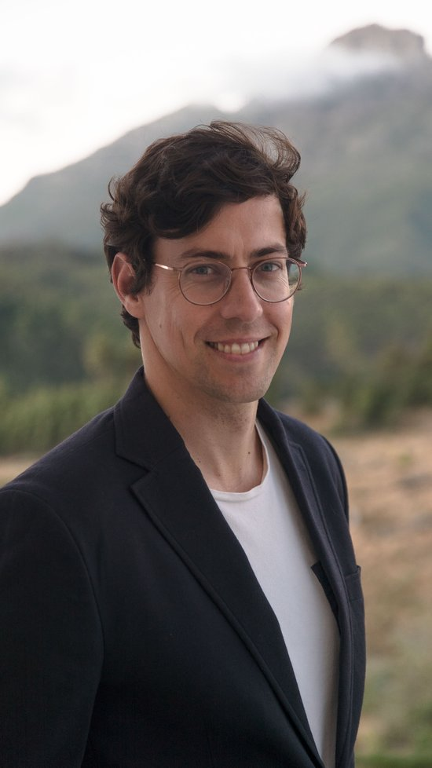

:::: {.profile-sidebar}
{fig-alt="Portrait of Johan Fourie"}

::: index-sidebar-icons
<a href="mailto:johanf@sun.ac.za" aria-label="Email"><i class="fa-solid fa-envelope"></i></a> <a href="https://orcid.org/0000-0002-7341-017X" aria-label="ORCID"><i class="ai ai-orcid"></i></a> <a href="https://github.com/johanfourieza" aria-label="GitHub"><i class="fa-brands fa-github"></i></a> <a href="https://x.com/johanfourieza" aria-label="X"><i class="fa-brands fa-x-twitter"></i></a> <a href="https://www.linkedin.com/in/johan-fourie-72b2204/" aria-label="LinkedIn"><i class="fa-brands fa-linkedin"></i></a> <a href="https://www.instagram.com/johanfourieza" aria-label="Instagram"><i class="fa-brands fa-instagram"></i></a> <a href="https://johanfourie.substack.com" aria-label="Substack"><i class="fa-solid fa-newspaper"></i></a>
:::
::::

**How do we build a prosperous South Africa? That question sits at the heart of everything I do.** I am Professor of Economics and Chair of Economics, History and Policy at Stellenbosch University, where I teach economic history and economic policy. I study the past to understand the present, and to draw from history the lessons we need to build a better future. My [research page](research.qmd) sets out the questions I think are most important to study now, and my [public page](public.qmd) links to the policy reports I've prepared to help guide us forward.

The lessons of history are only useful if people know about them. That is why I invest so much time in bringing others' research to new audiences. My book, [*Our Long Walk to Economic Freedom*](https://www.cambridge.org/core/books/our-long-walk-to-economic-freedom/0985F9390A3B26B40DE0AC6BC1111414) (CUP), offers an accessible and engaging introduction to economic history from an African perspective. Its closing line – 'The future belongs to those who believe in a better tomorrow' – captures my conviction that economic history is fundamentally optimistic: we have the agency to build a more prosperous society. You can read the entire book for free on my [books page](books.qmd).

I see myself as a knowledge broker. Effective science communication matters deeply: stories not only help us understand the world around us, they actively shape it. My blog, [ourlongwalk.com](http://www.ourlongwalk.com), now followed by more than 6,000 subscribers, features my columns and essays on a wide variety of topics – do subscribe. For my public talks, podcasts and media appearances, visit my [public page](public.qmd).

The history of human progress is a history of innovation. Artificial intelligence offers extraordinary opportunities for human advancement, though not without risks. I study, and use, AI through a historical lens, and I help business leaders and managers navigate this transformative period. I am also an Affiliate at the [Center for Human Progress](https://www.centerforhumanprogress.org/). If you'd like to book me for a talk or a session with your team, see [speaking and consulting](public.qmd#consult).

Understanding a technology this transformative demands experimentation. I believe universities, and the people who work in them, are best placed to do it: to act as scouts – *voorlopers* – for what advanced intelligence could do to improve human prosperity. The tools of economics are ideally suited to the task. If you'd like to join my team or support our work, [I'd love to hear from you](mailto:johanf@sun.ac.za).

```{=html}
<div class="bio-box">
  <h2 class="bio-box-heading">Short bio (for introductions)</h2>
  <p>Johan Fourie is Professor of Economics and Chair of Economics, History and Policy at Stellenbosch University, and the founder of LEAP, the Laboratory for the Economics of Africa’s Past. An economic historian, he studies the past to understand how South Africa, and Africa more broadly, can build a more prosperous future. He is the author of <em>Our Long Walk to Economic Freedom</em> (Cambridge University Press) and writes the blog <em>Our Long Walk</em>, read by more than 6,000 subscribers. He also advises business leaders on navigating the age of artificial intelligence.</p>
</div>
```

::: {.substack-section}

```{=html}
<div class="substack-header">
  <h2 class="substack-heading">Latest from <a href="https://www.ourlongwalk.com">Our Long Walk</a></h2>
  <a class="substack-all" href="https://www.ourlongwalk.com/archive" target="_blank" rel="noopener">All essays&nbsp;&rarr;</a>
</div>
```

::: {#substack-feed .substack-grid}
:::

:::

```{=html}
<script>
(function() {
  // The feed JSON is refreshed by .github/workflows/substack-feed.yml and
  // served same-origin, so this fetch needs no CORS proxies.
  const NUM_POSTS = 3;
  const MONTHS = ["January", "February", "March", "April", "May", "June",
    "July", "August", "September", "October", "November", "December"];

  function formatDate(iso) {
    if (!iso) return "";
    var p = iso.split("-");
    if (p.length !== 3) return "";
    return parseInt(p[2], 10) + " " + (MONTHS[parseInt(p[1], 10) - 1] || "") + " " + p[0];
  }

  function el(tag, className, text) {
    var node = document.createElement(tag);
    if (className) node.className = className;
    if (text) node.textContent = text;
    return node;
  }

  function renderPosts(posts) {
    var grid = document.getElementById("substack-feed");
    if (!grid) return;
    grid.innerHTML = "";
    posts.slice(0, NUM_POSTS).forEach(function(post) {
      var card = el("a", "substack-card");
      card.href = post.link;
      card.target = "_blank";
      card.rel = "noopener";

      if (post.image) {
        var frame = el("div", "substack-card-img");
        var img = document.createElement("img");
        img.src = post.image;
        img.alt = "";
        img.loading = "lazy";
        frame.appendChild(img);
        card.appendChild(frame);
      }

      var body = el("div", "substack-card-body");
      var date = formatDate(post.date);
      if (date) body.appendChild(el("p", "substack-card-date", date));
      body.appendChild(el("p", "substack-card-title", post.title));
      if (post.description) body.appendChild(el("p", "substack-card-desc", post.description));
      card.appendChild(body);
      grid.appendChild(card);
    });
  }

  function showFallback() {
    var grid = document.getElementById("substack-feed");
    if (!grid) return;
    grid.innerHTML = "";
    var p = el("p", "substack-fallback", "Visit ");
    var a = el("a", null, "ourlongwalk.com");
    a.href = "https://www.ourlongwalk.com";
    p.appendChild(a);
    p.appendChild(document.createTextNode(" for the latest posts."));
    grid.appendChild(p);
  }

  fetch("data/substack.json")
    .then(function(resp) {
      if (!resp.ok) throw new Error("HTTP " + resp.status);
      return resp.json();
    })
    .then(function(data) {
      if (data && data.posts && data.posts.length) renderPosts(data.posts);
      else showFallback();
    })
    .catch(showFallback);
})();
</script>
```
